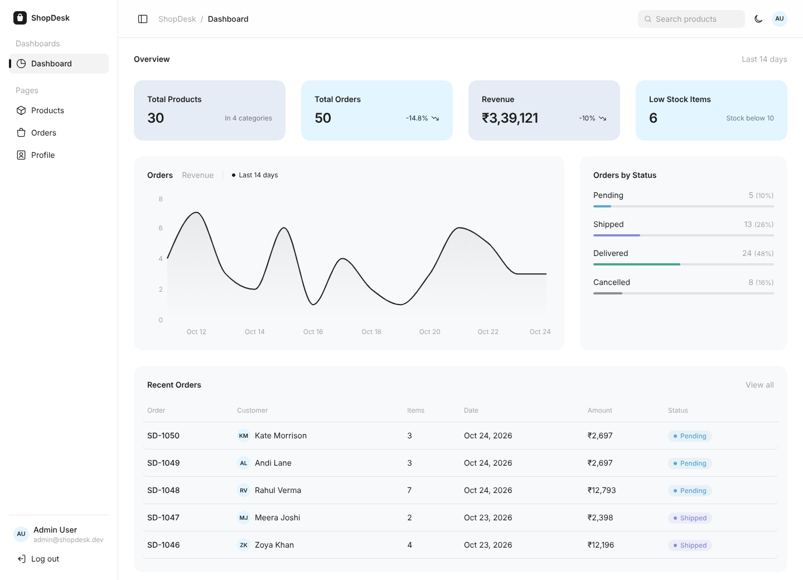
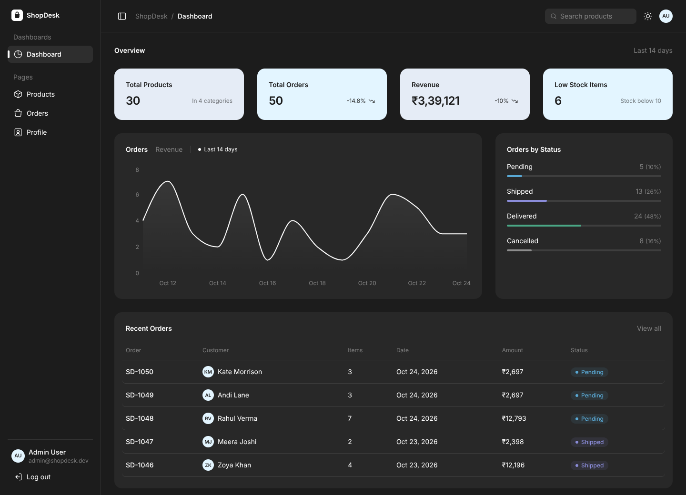
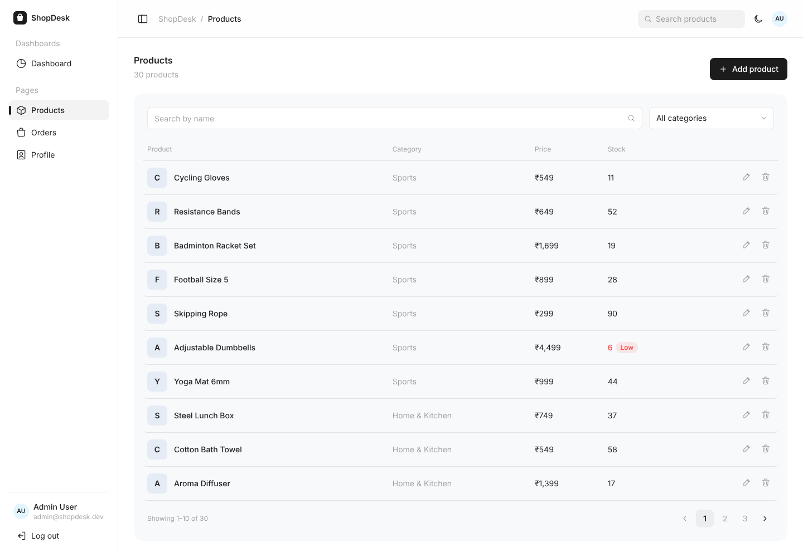
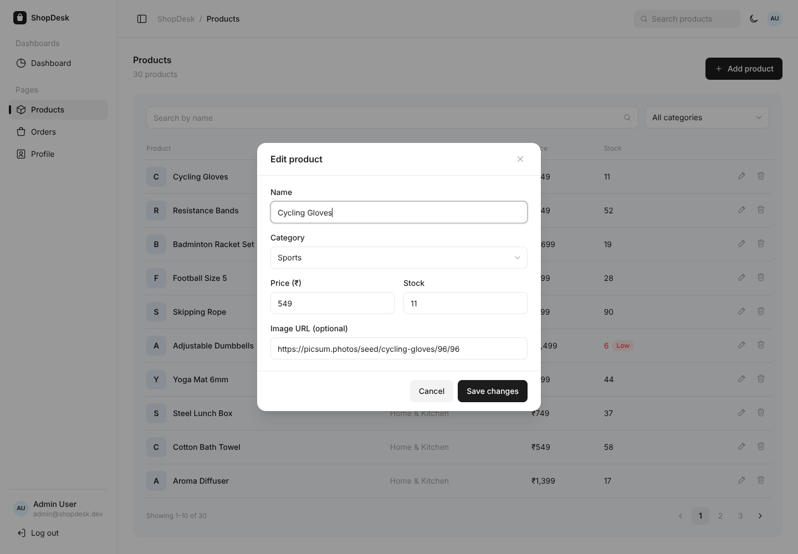
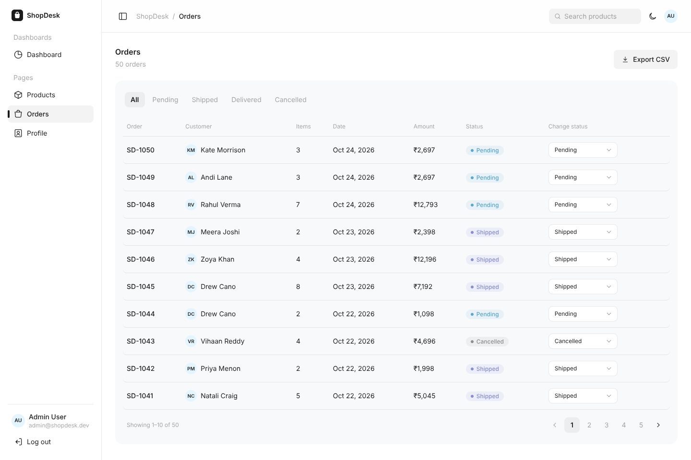
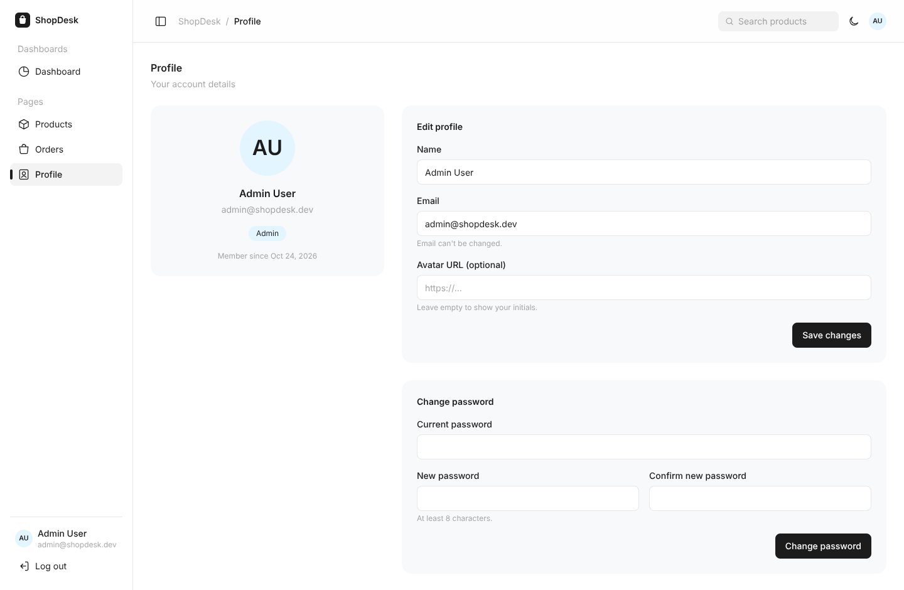
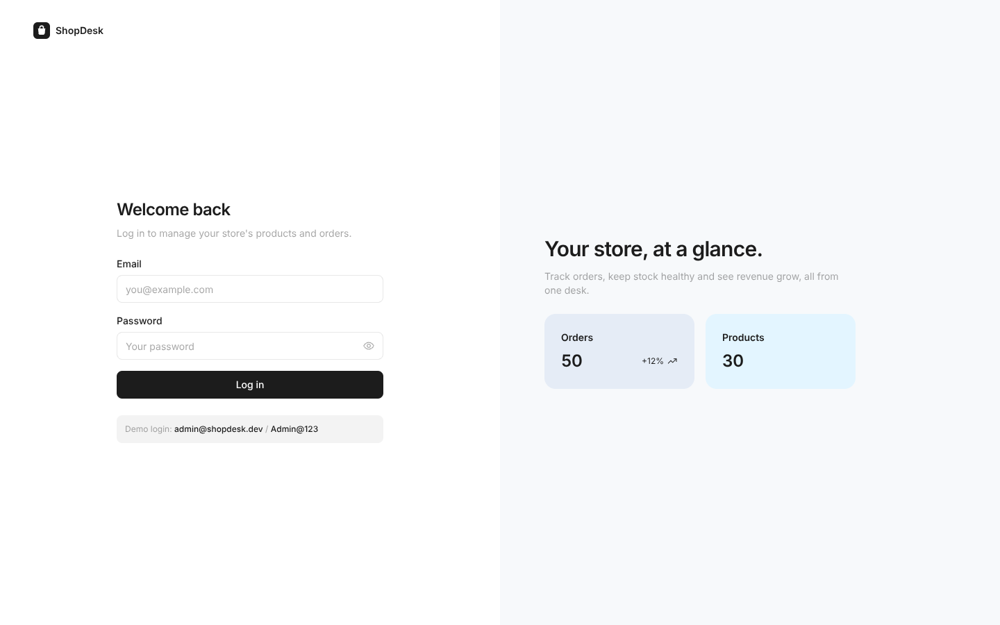
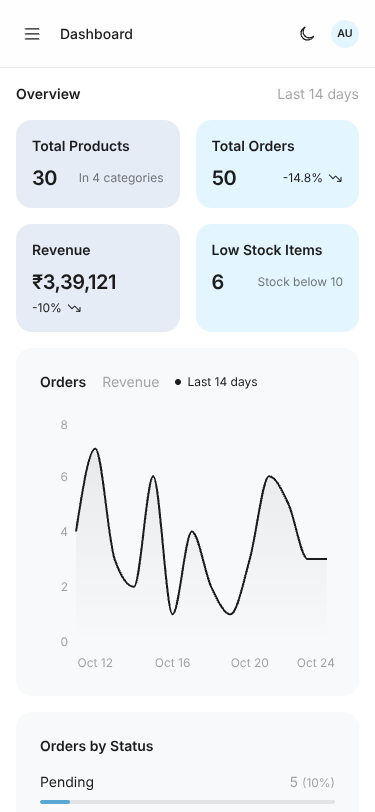
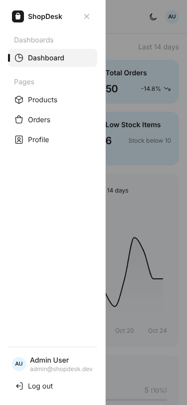

# ShopDesk – Store Admin Dashboard

A responsive store admin dashboard built from the **Free Admin Dashboard UI Kit (ByeWind / SnowUI)** Figma template, with a REST API of its own.

| | |
|---|---|
| **Live frontend** | https://shopdesk-orpin.vercel.app |
| **Live backend** | https://shopdesk-oq1n.onrender.com (health check: [`/api/health`](https://shopdesk-oq1n.onrender.com/api/health)) |
| **Figma file** | [My copy of the template](https://www.figma.com/design/5oiogra5AzhvVf6TB9joV0/Dashboard-UI-Kit---Dashboard--Free-Admin-Dashboard--Community-?node-id=0-1) |
| **Figma template** | [Free Admin Dashboard UI Kit (Community)](https://www.figma.com/community/file/1210542873091115123/dashboard-ui-kit-dashboard-free-admin-dashboard) |
| **Demo login** | `admin@shopdesk.dev` / `Admin@123` |

> The backend runs on Render's free plan, which sleeps when unused. The first request can take up to a minute.



## Tech stack

| Part | Choice |
|---|---|
| Frontend | React 19 + Vite, React Router, Tailwind CSS v4 (no UI kit), Recharts, Axios |
| Backend | Node.js + Express 5 REST API, JWT auth (jsonwebtoken), bcrypt password hashes |
| Database | MongoDB Atlas (free tier) with Mongoose |
| Tests | Vitest + Testing Library (frontend), `node:test` (API) |
| Deploy | Vercel or Netlify (frontend), Render (backend) |

## Folder structure

```
shopdesk/
├── client/                    React app
│   └── src/
│       ├── api/               axios setup + one function per endpoint
│       ├── components/
│       │   ├── ui/            Button, Input, Select, Card, Table, Modal, Badge, Toast, StatCard...
│       │   ├── layout/        Sidebar, Topbar, AppLayout, ProtectedRoute
│       │   ├── dashboard/     OrdersChart, StatusBreakdown
│       │   ├── products/      ProductFormModal, ProductThumb
│       │   └── orders/        shared order table columns
│       ├── context/           Auth, Toast, Theme (dark mode)
│       ├── hooks/useApi.js    loading / error / data / reload for every screen
│       ├── pages/             Login, Dashboard, Products, Orders, Profile
│       ├── theme/theme.css    colours, font, radius, sizes from Figma (Tailwind tokens)
│       └── utils/             validation, formatting, CSV export
├── server/                    Express API
│   ├── routes/                auth, stats, products, orders, users
│   ├── models/                Product, Order, User (Mongoose schemas)
│   ├── middleware/            auth (JWT check), errorHandler
│   ├── config/db.js           MongoDB connection
│   ├── seed.js                demo data
│   ├── tests/api.test.js      API tests
│   └── docs/                  Postman collection
└── docs/screenshots/
```

## Run it locally

You need **Node.js 20 or newer** and a **MongoDB Atlas** database (the free M0 cluster is enough).

**0. MongoDB Atlas**
1. In Atlas, create a free cluster.
2. Under **Database Access**, add a database user with a password.
3. Under **Network Access**, add your IP. For Render, add `0.0.0.0/0` (allow from anywhere).
4. Go to **Connect → Drivers** and copy the connection string. Put `shopdesk` as the database name after `.net/`.

**1. Backend**

```bash
cd server
npm install
cp .env.example .env        # then set JWT_SECRET and MONGO_URI
npm run seed                # creates the demo user, 30 products and 50 orders
npm run dev                 # API on http://localhost:5000
```

To make a JWT secret: `node -e "console.log(require('crypto').randomBytes(32).toString('hex'))"`

**2. Frontend** (in a second terminal)

```bash
cd client
npm install
cp .env.example .env        # VITE_API_URL=http://localhost:5000/api
npm run dev                 # app on http://localhost:5173
```

Log in with `admin@shopdesk.dev` / `Admin@123`.

> `npm run seed` wipes the data and starts fresh. If the database is empty, the server also seeds itself on start.

### Environment variables

`server/.env` (see `server/.env.example`)

| Name | What it is |
|---|---|
| `PORT` | Port for the API (Render sets it for you) |
| `JWT_SECRET` | Secret used to sign login tokens. **Never commit it.** |
| `JWT_EXPIRES_IN` | How long a login lasts, e.g. `7d` |
| `MONGO_URI` | MongoDB connection string. **Never commit it.** |
| `CLIENT_URL` | Frontend URL(s) allowed by CORS, comma separated |
| `TZ` | Time zone for grouping orders by day, e.g. `Asia/Kolkata` |

`client/.env` (see `client/.env.example`)

| Name | What it is |
|---|---|
| `VITE_API_URL` | Backend URL ending in `/api` |

## Tests

The API tests delete and re-create all data, so give them a **separate** database by setting `MONGO_URI_TEST` (same cluster, different name such as `shopdesk-test`). Without it, they are skipped.

```bash
# PowerShell: $env:MONGO_URI_TEST="mongodb+srv://.../shopdesk-test"
# Mac/Linux:  export MONGO_URI_TEST="mongodb+srv://.../shopdesk-test"
```

```bash
cd server && npm test      # 11 API tests: login, JWT, CRUD, filters, pagination, stats, profile
cd client && npm test      # 20 tests: Button, Badge, Input components + form validation
```

## API

All routes except `POST /api/auth/login` (and `GET /api/health`) need `Authorization: Bearer <token>`.

| Method | Route | What it does |
|---|---|---|
| POST | `/api/auth/login` | Check email + password, return `{ token, user }` |
| GET | `/api/auth/me` | Current user |
| GET | `/api/stats` | Card numbers, orders per day (14 days), status counts, 5 recent orders |
| GET | `/api/products?search=&category=&page=` | 10 products per page |
| POST | `/api/products` | Create a product |
| PUT | `/api/products/:id` | Update a product |
| DELETE | `/api/products/:id` | Delete a product |
| GET | `/api/orders?status=&page=&limit=` | Orders, newest first |
| PATCH | `/api/orders/:id/status` | Change an order's status |
| PUT | `/api/users/me` | Update name / avatar / password |

Errors always look like `{ "message": "...", "errors": { "field": "..." } }`, with status 400 (bad input), 401 (not logged in), 404 (not found) or 500.

**Postman:** import `server/docs/ShopDesk.postman_collection.json`, run **Login** first (it saves the token), then any other request. Change the `baseUrl` variable to test the live API.

## Deploy

**Backend on Render**
1. New → Web Service → connect the repo. Root directory: `server`.
2. Build command: `npm install`. Start command: `npm start`.
3. Environment: `MONGO_URI`, `JWT_SECRET` (random), `CLIENT_URL` (your frontend URL), `TZ=Asia/Kolkata`.
4. In Atlas **Network Access**, allow `0.0.0.0/0` so Render can connect.
5. On the first start, if the database is empty, the server creates the demo data by itself.

> On Render's free plan the API sleeps after 15 minutes without visits, so the first request can take about 50 seconds. Open the backend URL once before your demo.

**Frontend on Vercel** (or Netlify)
1. Import the repo, root directory: `client`. Framework: Vite.
2. Environment variable: `VITE_API_URL=https://<your-render-app>.onrender.com/api`.
3. `client/vercel.json` (Vercel) and `client/public/_redirects` (Netlify) make page refreshes on `/products` etc. work.

## Screenshots

| Light | Dark |
|---|---|
|  |  |
|  |  |
|  |  |
|  |   |

## Done / not done

**Done**
- [x] Login with validation, API error message, redirect back to the page you wanted
- [x] Dashboard: 4 stat cards, orders-per-day chart (with a revenue tab), orders by status, 5 recent orders
- [x] Products: search, category filter, 10 per page, add/edit modal, delete with confirmation
- [x] Orders: status badges, status filter, change status from a dropdown
- [x] Profile: avatar, name, email; edit name, avatar URL and password
- [x] Sidebar + top bar from the template, hamburger menu below 768px, active link highlighted, logout
- [x] Loading, empty and error (with "Try again") states on every screen
- [x] Protected routes, form validation in the browser **and** on the server, toasts after create/update/delete
- [x] All 10 API endpoints with JWT, seed script, Postman collection, API tests
- [x] Responsive at 375 / 768 / 1440px
- [x] Bonus: dark mode, export orders to CSV, unit tests for 3 components (Button, Badge, Input)

**Not done**
- [ ] TypeScript (bonus)
- [ ] Product image upload (bonus). Products take an image **URL** instead.
- [ ] Demo video
- [ ] Icons are hand-drawn SVGs in the template's style. Swap in the SVGs exported from Figma if needed (`client/src/components/ui/icons.jsx`).
